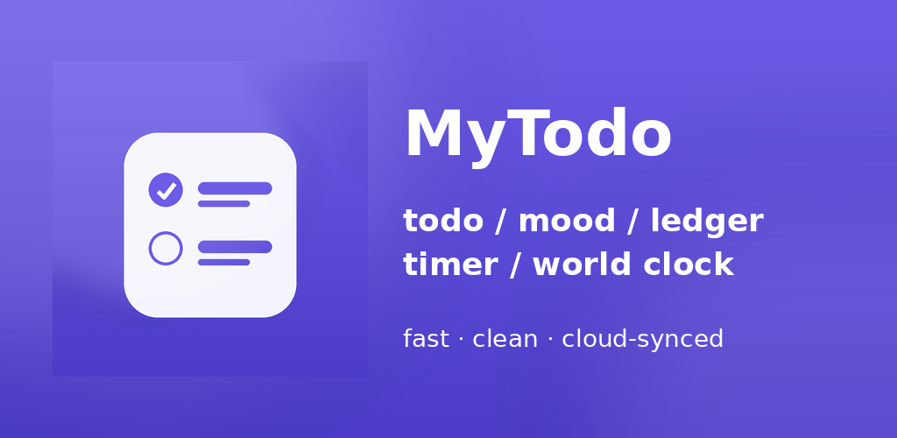
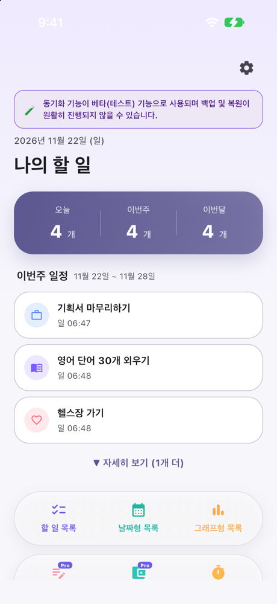
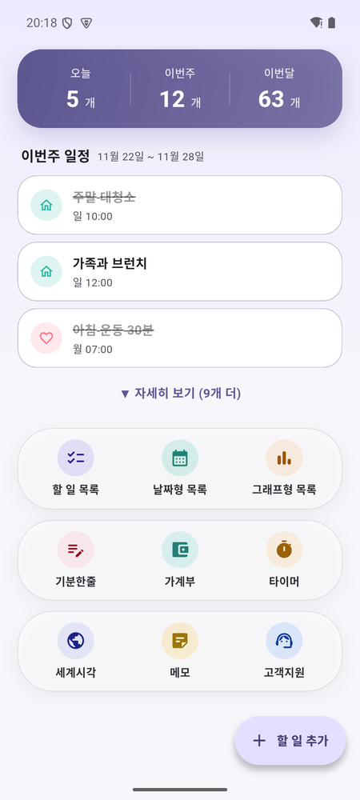
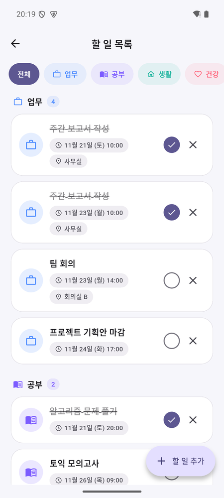
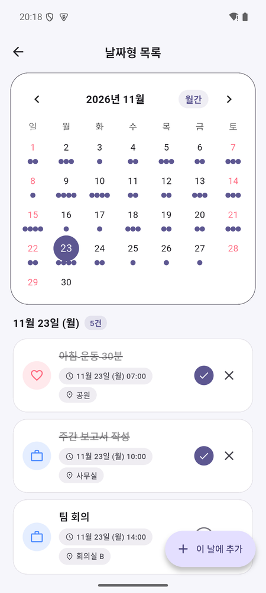
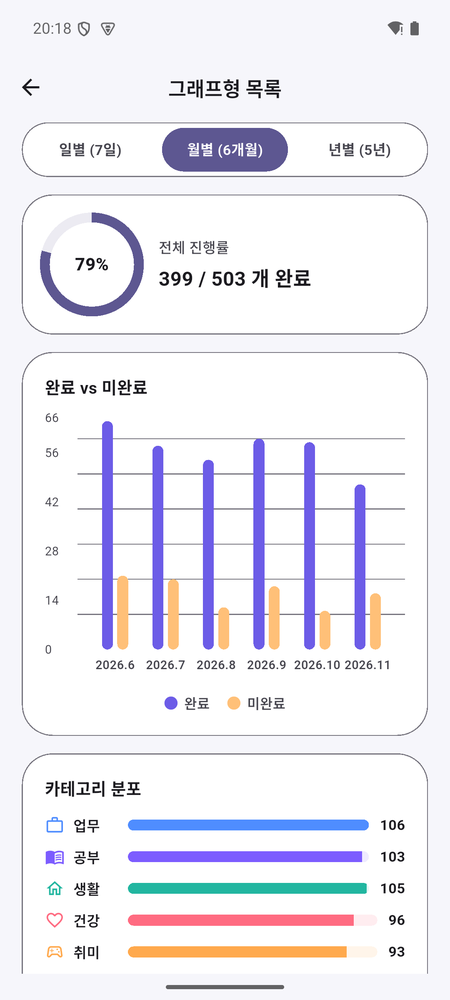
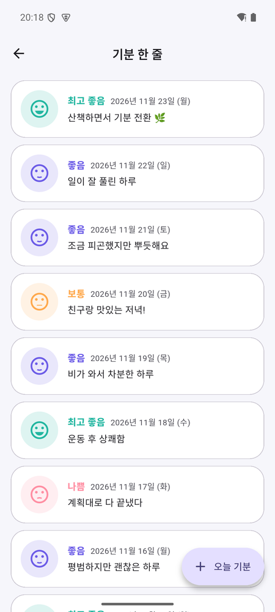
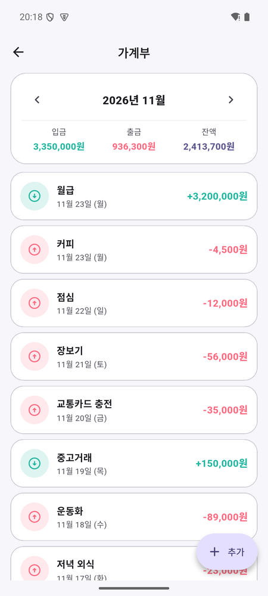
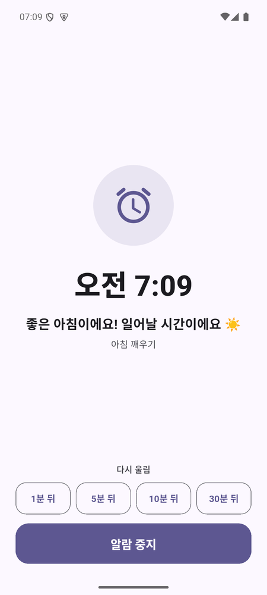
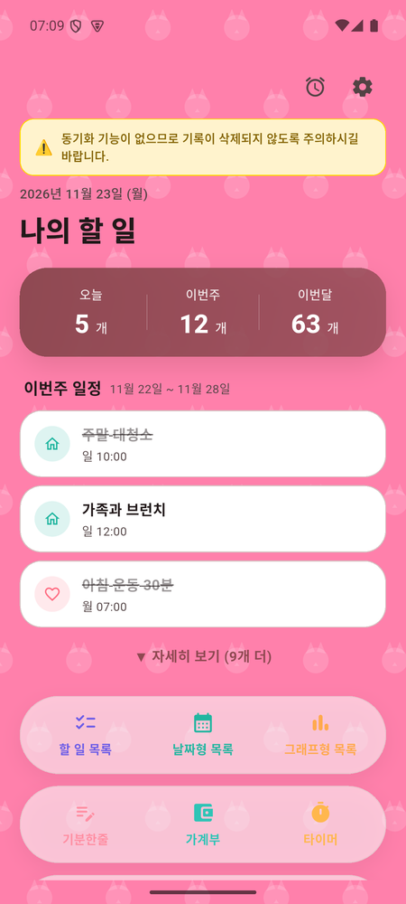

# ✅ 나의 할 일 (mytodo)



할 일 관리를 중심으로 캘린더·통계 그래프·가계부·기분 기록·타이머·세계시각까지 한 앱에서 관리하는 **올인원 라이프 관리 Flutter 앱**입니다.

> 📱 **Google Play 출시 예정** — 현재 비공개 테스트 중입니다. (Android / iOS)  
> 🏷 **최신 버전:** 1.6.3 (빌드 43) — 2026년 11월 24일 비공개 테스트 배포

## 스크린샷

| 홈 | 홈 메뉴 | 할 일 목록 |
|:---:|:---:|:---:|
|  |  |  |

| 캘린더 | 통계 | 기분 한 줄 |
|:---:|:---:|:---:|
|  |  |  |

| 가계부 | 알람 | 고양이 테마 |
|:---:|:---:|:---:|
|  |  |  |

## 주요 기능

- **할 일 관리** — 카테고리(업무·공부·생활·건강·취미)별 정리, 장소·메모 태깅
- **캘린더 · 통계** — 날짜별 일정 보기, 완료율과 카테고리 분포 그래프
- **가계부 · 기분 기록** — 수입/지출 통계, 날짜별 기분 로그
- **알람** — 1분간 울리는 알람 화면, 1·5·10·30분 다시 울림
- **메모 · 홈 화면 위젯** — 글 서식(크기·굵게·밑줄·정렬)과 손글씨·그림·글상자를 담는 색상 메모, Android/iOS 홈 화면 위젯
- **타이머 · 세계시각** — 집중 타이머, 여러 도시 시각 동시 조회
- **클라우드 동기화** (Beta) — Google 로그인 + Firestore 백업/복원
- **알림 · 공휴일** — 일일 알림, 한국/일본 공휴일 자동 반영
- **등급별 권한 관리** — 관리자·베타·프로·학생·일반 5단계 접근 권한
- **다국어 · 테마** — 5개 언어, 시스템·고양이·강아지·기린·커피 테마
- **보기 편하게** — 큰 글씨 모드(기본·크게·아주 크게), 대비를 높인 홈 메뉴, 홈 화면 메뉴 켜고 끄기·순서 바꾸기, 홈에서 바로 할 일 추가
- **삭제 되돌리기 · 백업 파일** — 지운 기록 바로 되살리기, 기록을 JSON 파일로 내보내고 불러오기

## 최근 업데이트 (v1.6.3)

- **메모 글 서식** — 글자 크기, 굵게, 기울임, 밑줄, 취소선, 글자색, 형광, 정렬, 번호·글머리 목록, 체크리스트
- **메모 그림 그리기** — 펜·형광펜·지우개(부분/획)·글상자·이동 도구, 실행 취소·다시 실행, 두 손가락 스크롤
- **메모 목록 최적화** — 화면 폭에 따라 2~6칸으로 배치해 휴대폰 가로 화면·태블릿에서도 카드가 알맞은 크기로 보이고, 그림 메모는 미리보기 표시
- **가로 화면 배치** — 세로가 짧은 화면에서는 제목·전환 버튼을 상단 바로, 그리기 도구를 왼쪽 막대로 옮겨 작업 영역 확보
- 예전 메모·검색·홈 화면 위젯·백업 파일과 그대로 호환

이전 버전의 변경 내역은 [PORTFOLIO.md](PORTFOLIO.md)의 업데이트 내역에 정리되어 있습니다.

## 기술 스택

| 분류 | 기술 |
|------|------|
| 언어 / 프레임워크 | Dart, Flutter |
| 인증 / DB | Firebase Auth (Google Sign-In), Cloud Firestore |
| 로컬 저장 / 알림 | SharedPreferences, flutter_local_notifications |
| UI | table_calendar, fl_chart, flutter_quill (메모 서식) |
| 홈 화면 위젯 | home_widget (Android RemoteViews, iOS WidgetKit) |
| 백업 파일 | share_plus, file_picker |
| 빌드 · 보안 | R8 코드 축소·난독화, Dart 난독화(`--obfuscate`) |
| 기타 | http, package_info_plus |

자세한 개발 내용은 [PORTFOLIO.md](PORTFOLIO.md)에 정리되어 있습니다.
다른 프로젝트와 함께 [포트폴리오 사이트](https://herjy6372.github.io/portfolio/)에서도 볼 수 있습니다.
만들면서 해결한 문제(등급별 권한, R8 난독화, 홈 화면 위젯)는 [개발 블로그](https://herjy6372.github.io/blog/ko/projects/mytodo/)에 글로 정리했습니다.

## 로컬 설정

이 저장소에는 비밀 키가 포함되어 있지 않습니다. 빌드하기 전에 아래 파일을 직접 준비하세요.

1. **API 키**: `lib/config/api_keys.example.dart` 파일을 `lib/config/api_keys.dart`로 복사한 뒤, 공공데이터포털에서 발급받은 키를 입력합니다.
2. **운영자 설정**: `lib/config/private_config.example.dart` → `lib/config/private_config.dart`, `firestore.rules.example` → `firestore.rules` 로 복사한 뒤 `admin@example.com` 을 운영자 이메일로 바꿉니다.
3. **Android 릴리스 서명** (선택): `android/key.properties.example` 파일을 참고해 `android/key.properties`를 만들고, 키스토어 파일을 준비합니다.

```bash
flutter pub get
flutter run
```
